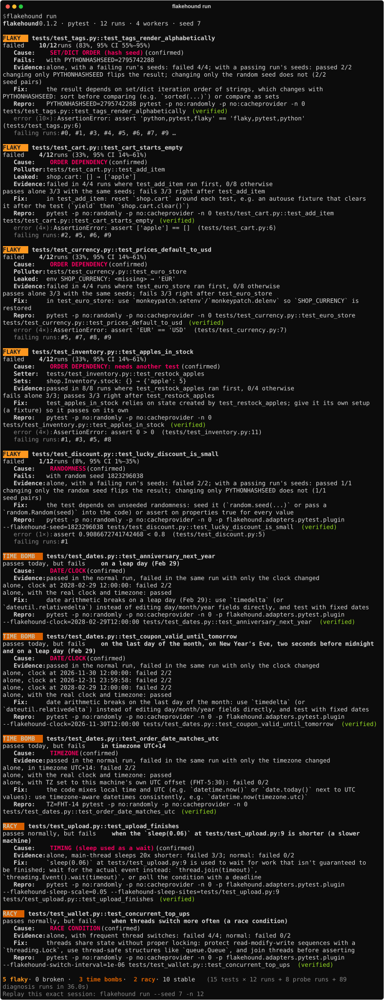

# flakehound

[](https://pypi.org/project/flakehound/)
[](https://pypi.org/project/flakehound/)
[](https://github.com/urumb/flakehound/actions/workflows/ci.yml)
[](https://github.com/urumb/flakehound/actions/workflows/codeql.yml)
[](https://scorecard.dev/viewer/?uri=github.com/urumb/flakehound)
[](https://github.com/urumb/flakehound/blob/main/LICENSE)

**Find flaky tests and prove *why* they're flaky.**

Flaky tests pass sometimes and fail sometimes with no code change. Most tools just retry
them, which hides the problem. flakehound runs your pytest suite under deliberately hostile
conditions, finds the tests that flip, and tells you the cause, with evidence from real runs
and a command that reproduces it. It also finds problems that haven't bitten you *yet*.



- 🆓 **Free forever.** No accounts, no servers, no paid services.
- 🔒 **Local and private.** Offline, no telemetry, secrets redacted from every report.
- 🧪 **Evidence, not guesses.** Every verdict comes from runs that prove it, and every repro
  command is run for real before it's marked *verified*.

## What it finds

| Problem | Example | What flakehound tells you |
|---|---|---|
| **Order dependency** | a test leaves an item in a shared cart | the polluter test and the leaked state: `shop.cart: [] → ['apple']` |
| **Needs another test** | a test only passes after a setup-like test ran | the test it secretly depends on |
| **Randomness** | `assert random.random() < 0.8` | the failing seed, and a repro that replays it |
| **Set/dict ordering** | comparing `",".join(a_set)` to a string | that `PYTHONHASHSEED` is the cause |
| **Time bombs** | breaks on the last day of the month, on Feb 29, in another timezone | the exact date/timezone, *before* it happens |
| **Sleep used as a wait** | `sleep(0.06)` then assert a thread finished | the exact `sleep()` line that will fail on a slow CI machine |
| **Race conditions** | unlocked read-modify-write from threads | that it fails when threads interleave |

## Quickstart

```bash
pip install flakehound
cd your-project
flakehound run
```

That's it: no config. Try it on the included [demo project](https://github.com/urumb/flakehound/tree/main/demo) to see every kind of
problem. The same results as a Markdown report: [docs/example-report.md](https://github.com/urumb/flakehound/blob/main/docs/example-report.md).

> ⚠️ flakehound **runs your test suite** (many times). Only run it on code you trust.

### Options

| Option | Meaning |
|---|---|
| `-n, --runs N` | How many times to run the suite (default 10) |
| `-j, --workers N` | Parallel runs (default: CPU cores − 1, max 8) |
| `--seed N` | Replay an earlier session exactly |
| `--json PATH` | Also write a machine-readable report |
| `--markdown PATH` | Also write a Markdown report (for PR comments) |
| `--fail-on KINDS` | What makes exit code 1: `flaky`, `time-bomb`, `racy`, `broken`, `suspected`, `none` (default `flaky,time-bomb,racy`) |
| `--no-diagnose` | Only detect flaky tests, don't explain them |
| `--max-diagnose N` | Diagnose at most N flaky tests (default 20) |
| `--no-probes` | Skip all probe runs (timezones, risky dates, timing) |
| `--no-timing` | Skip only the timing probes |
| `--no-step-summary` | Don't add the report to the GitHub Actions job summary |
| `--timeout S` | Kill a single run after S seconds (default 600) |
| `-- ARGS` | Anything after `--` goes straight to pytest |

Exit codes: `0` no problems, `1` problems found (by default only flaky tests and *confirmed*
time bombs or racy tests fail a build), `2` usage or collection error.

## In CI (GitHub Action)

Hunting runs your suite many times, so run it on a schedule rather than on every push:

```yaml
# .github/workflows/flakehound.yml
on:
  schedule: [{ cron: "0 3 * * *" }]   # nightly
  workflow_dispatch:
permissions:
  contents: read
jobs:
  hunt:
    runs-on: ubuntu-latest
    steps:
      - uses: actions/checkout@3d3c42e5aac5ba805825da76410c181273ba90b1 # v7.0.1
        with: { persist-credentials: false }
      - uses: actions/setup-python@6d4fd22b20465ccc0f7354476588e8df7c9ca0e0 # v7.1.0
        with: { python-version: "3.12" }
      - run: pip install -e .            # your project and its test dependencies
      - uses: urumb/flakehound@v0.1.1    # or pin the release's commit SHA
        with:
          args: -n 20                    # any `flakehound run` options
```

| Input | Default | Meaning |
|---|---|---|
| `args` | `""` | Options for `flakehound run`, e.g. `-n 20 --fail-on flaky` |
| `working-directory` | `.` | Where your tests live |
| `report` | `flakehound-report.json` | JSON report path (an output, too) |

The Markdown report appears on the run's summary page, and the step fails when
problems are found (see `--fail-on`). Upload `flakehound-report.json` with
`actions/upload-artifact` if you want to keep it, or feed it to
`flakehound quarantine add --from-report`. Without the action, `pip install flakehound`
and `flakehound run` work the same way.

## Quarantine

Found a flaky test you can't fix today? Quarantine it so it stops failing the build, without
hiding it:

```bash
flakehound quarantine add tests/test_cart.py::test_cart_starts_empty --reason "polluted by test_add_item"
flakehound quarantine add --from-report flakehound.json    # everything flakehound found
flakehound quarantine list
flakehound quarantine remove tests/test_cart.py::test_cart_starts_empty
```

- The list is one file, `.flakehound/quarantine.toml`: commit it, review it, revert it.
  flakehound never edits your test files.
- Every change shows a diff and asks first (`--yes` skips the prompt).
- pytest still runs quarantined tests as non-strict `xfail` (or `skip`), so you see `XPASS`
  once one is fixed. Disable for one run with `pytest -p no:flakehound-quarantine`. The
  plugin does nothing when the file doesn't exist.
- `flakehound run` ignores the quarantine, so quarantined tests keep being hunted.

## How it works

flakehound changes **one factor at a time**, like a science experiment:

1. **Shake.** Run the whole suite many times in parallel, each with a different test order,
   `random` seed and `PYTHONHASHSEED`, all recorded. Tests that both pass and fail are
   flaky; tests that always fail are rechecked, then reported as broken.
2. **Isolate.** Run each flaky test alone with the *exact seeds* of the runs where it
   failed. Only the order changed, so if it now passes, order is proven to be the cause.
3. **Find the culprit.** Try the tests whose position best correlates with the failure,
   then shrink the preceding tests with delta debugging, in parallel batches.
4. **Name the leaked state.** Snapshot global state before and after the culprit: module
   variables, object and class attributes, environment variables (secret values are never
   shown), working directory, `sys.path`, project files and logging config.
5. **Seeds.** For flaky tests that aren't about order, swap *one* seed at a time between a
   failing and a passing run: the one that flips the result is the cause. If identical
   seeds still give different results, the test is nondeterministic.
6. **Time bomb probes.** Runs with the baseline's exact order and seeds, but in UTC+14,
   UTC−12, just before midnight, on the last day of the month, on New Year's Eve and on
   Feb 29. The clock is *shifted*, not frozen, so code that waits on time still works.
7. **Timing probes.** One run where every `sleep()` on the test's main thread is 20×
   shorter (background work keeps its real speed, like a slow machine), and one where
   threads switch far more often. Then one `sleep()` call site at a time, to find the line.
8. **Confirm and verify.** Findings are re-run, and each printed repro command is run for
   real; it's marked *verified* only if it fails exactly as printed.

Repro commands that replay a seed, clock or timing stress use flakehound's pytest plugin
(`-p flakehound.adapters.pytest.plugin`), so they need flakehound installed. That plugin
never loads into your normal pytest runs on its own.

## How it compares

| Tool | Retries | Detects | Explains why | Free & local |
|---|---|---|---|---|
| pytest-rerunfailures, flaky | ✅ | ❌ | ❌ | ✅ |
| pytest-randomly | ❌ | order/seed issues show up | ❌ | ✅ |
| detect-test-pollution | ❌ | ❌ | the polluter test (you drive it) | ✅ |
| Trunk, BuildPulse, Datadog | ✅ | from CI history | little | ❌ paid / uploads data |
| **flakehound** | ❌ (on purpose) | ✅ + time bombs + racy tests | polluter, leaked state, seed, date, timezone, `sleep()` line, race | ✅ |

## Limitations

- Python + pytest only, for now.
- `asyncio.sleep` is not shortened by the timing probes.
- State hidden in fixtures, databases or external services can't be seen by the leak
  detector; the report says so instead of guessing.
- Thread stress exposes races that happen around Python function calls.
- Hunting takes many runs of your suite: use `-n`, `-j` and `--max-diagnose` on large suites.

## Roadmap

- GitHub Actions history mode: find flaky tests from past CI runs without running anything
- Adapters for Jest/Vitest, Go test and JUnit
- Optional AI explanations (local models via Ollama, or your own key; never required)

See [CHANGELOG.md](https://github.com/urumb/flakehound/blob/main/CHANGELOG.md) for what's in each release.

## Contributing and security

Contributions are welcome: see [CONTRIBUTING.md](https://github.com/urumb/flakehound/blob/main/CONTRIBUTING.md). To report a
vulnerability privately, see [SECURITY.md](https://github.com/urumb/flakehound/blob/main/SECURITY.md).

## License

MIT
